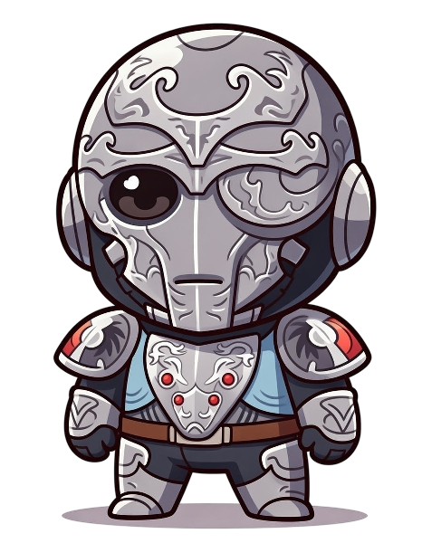

# BARAS

The **Battle Analysis and Raid Assessment System** (BARAS) is the ultimate companion for SWTOR endgame content.

<p align="center">
  
</p>

<p align="center">
  <a href="https://baras-app.github.io">Website</a> &nbsp;&middot;&nbsp;
  <a href="https://discord.gg/zmtkYkhSM4">
    
  </a>
</p>

> **Questions, bugs, or feedback?** Join the [Discord server](https://discord.gg/zmtkYkhSM4) — it's the fastest way to get help.

## Installation

See the [installation guide](https://baras-app.github.io/getting-started/installation/) on the official website to install a release version and view documentation and features.

## Platform Support

| Platform      | Status                   |
| ------------- | ------------------------ |
| Windows 10/11 | ✔️ Native                |
| Linux         | ✔️ X11, Wayland Native   |
| MacOS         | 🟡 Native (experimental) |

## Building from Source

### Prerequisites

- [Rust](https://rustup.rs/) (stable toolchain)
- `wasm32-unknown-unknown` target: `rustup target add wasm32-unknown-unknown`
- [Dioxus CLI](https://dioxuslabs.com/): `cargo install dioxus-cli`
- [Tauri CLI](https://v2.tauri.app/): `cargo install tauri-cli`
- [just](https://github.com/casey/just) command runner (optional, for convenience commands)

#### Linux Dependencies

```
sudo apt-get install -y \
  libwebkit2gtk-4.1-dev \
  libjavascriptcoregtk-4.1-dev \
  libappindicator3-dev \
  librsvg2-dev \
  patchelf \
  libxdo-dev \
  libasound2-dev \
  libpipewire-0.3-dev
```

### Development

Build the parse-worker sidecar, then start the Tauri dev server with hot-reload:

```
just dev
```

This runs `cargo tauri dev` with the frontend served on `localhost:1420`.

### Release Build

Build the parse-worker sidecar and bundle platform-specific artifacts:

```
just bundle
```

There is no cross-platform compilation, the file type produced depends on your operating system:

- **Linux**: AppImage and `.deb` in `target/release/bundle/`
- **Windows**: NSIS installer in `target/release/bundle/nsis/`
- **macOS**: `.dmg` in `target/release/bundle/dmg/`

**Note:** You will receive an error message informing you that the compiled application is unsigned. This does not prevent the application from running.

### Manual Steps

If not using `just`, the parse-worker sidecar must be built and placed before the Tauri build:

```bash
# 1. Build the parse-worker
cargo build --release -p baras-parse-worker

# 2. Copy to Tauri's sidecar binaries directory with the target triple suffix
mkdir -p app/src-tauri/binaries
cp target/release/baras-parse-worker app/src-tauri/binaries/baras-parse-worker-<TARGET_TRIPLE>
#   Linux:   baras-parse-worker-x86_64-unknown-linux-gnu
#   Windows: baras-parse-worker-x86_64-pc-windows-msvc.exe
#   macOS:   baras-parse-worker-aarch64-apple-darwin

# 3. Build the app
cd app && cargo tauri build
```

### Validate Definitions

The `baras-validate` CLI tool replays combat logs against encounter definitions:

```
cargo run --bin baras-validate -- --boss revan --log test-log-files/operations/hm_tos_revan.txt
```

## Configuration

Application configuration directories are stored in:

- **Windows**: `%APPDATA%\baras\`
- **Linux/macOS**: `~/.config/baras/`

- `config.toml` - the primary configuration file saving global settings and overlay profiles
- `encounters` - timer definitions for bosses. Adding a file in the same format will load it into the app.
- `effects` - definitions for effects

## Disclaimer

BARAS is a fan-made project and is not affiliated with, endorsed by, or connected to Electronic Arts Inc., Broadsword Online Games Inc., or Lucasfilm Ltd.

Star Wars: The Old Republic and all related properties, including logos, character names, and game assets, are trademarks or registered trademarks of Lucasfilm Ltd. and/or Electronic Arts Inc.

This project is provided free of charge for personal, non-commercial use only.

## License

[MIT License](LICENSE.txt)
